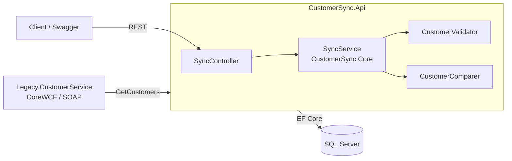

# Architecture

## Overview

## Projects

| Project | Type | Responsibility |
|---|---|---|
| `Legacy.CustomerService` | ASP.NET Core + CoreWCF | Simulates the legacy system. SOAP contract `ICustomerService`. Seeded with deterministic data, including anomalies. |
| `CustomerSync.Core` | Class library | Domain model, validation, comparison, sync orchestration. No dependency on EF or WCF: depends only on interfaces. |
| `CustomerSync.Infrastructure` | Class library | EF Core `DbContext` and migrations, SQL Server store, SOAP client implementing `ICustomerSource`. |
| `CustomerSync.Api` | ASP.NET Core Web API | REST endpoints, DI wiring, Swagger, health check. |
| `CustomerSync.Core.Tests` | xUnit | Unit tests for validation, comparison and `SyncService` (with fakes). |
| `CustomerSync.Api.Tests` | xUnit | Endpoint tests with `WebApplicationFactory` and a fake source. |

Dependencies point inward: `Api` → `Infrastructure` → `Core`.

### Why the SOAP contract is declared twice

CoreWCF (server) and `System.ServiceModel` (client) use different attribute types. The client in `Infrastructure` declares its own copy of the contract with the same XML namespace and operation names, exactly as a real consumer of a third-party SOAP service would. The WSDL is the shared agreement.

## Sync rules

The legacy system is the **source of truth** for customer data.

1. Fetch all customers from the legacy service.
2. Validate each record:
   - name is required;
   - email must be well-formed;
   - tax code must be present and 16 characters (person) or 11 digits (company VAT).
3. Detect duplicates in the source (same `LegacyId` appears twice).
4. Compare valid records with the target by `LegacyId`:
   - not in target: **insert**;
   - in target and different: **update** and record the changed fields;
   - identical: **unchanged**.
5. Customers present in the target but missing from the source are **flagged, never deleted**.
6. Everything is stored in a `SyncRun` with counters and a list of `Discrepancy` rows.

### Discrepancy types

| Type | Meaning | Action taken |
|---|---|---|
| `InvalidRecord` | Source record failed validation | Skipped, reported with the reason |
| `DuplicateInSource` | Same `LegacyId` returned more than once | First kept, rest reported |
| `OrphanedInTarget` | In SQL Server but no longer in the source | Left untouched, reported |

Running the sync twice with unchanged source data must produce zero inserts and zero updates (idempotent).

## REST API

| Method | Path | Description |
|---|---|---|
| POST | `/api/sync/runs` | Run a sync now, return the run summary |
| GET | `/api/sync/runs` | List runs, newest first |
| GET | `/api/sync/runs/{id}` | Run summary with counters |
| GET | `/api/sync/runs/{id}/discrepancies` | Discrepancies of a run, filterable by type |
| GET | `/health` | Liveness and database check |

## Decisions and trade-offs

- **Full fetch, not incremental.** Simple and correct for a demo-sized dataset. A `modifiedSince` operation on the legacy contract is the natural next step.
- **Flag, don't delete.** Deletions in an integration are risky; a person should decide.
- **Core has no framework dependencies,** so the business rules are tested without a database or a SOAP server.
- **Synchronous run via POST.** A background worker with a schedule would be the production choice; kept out of scope here.
